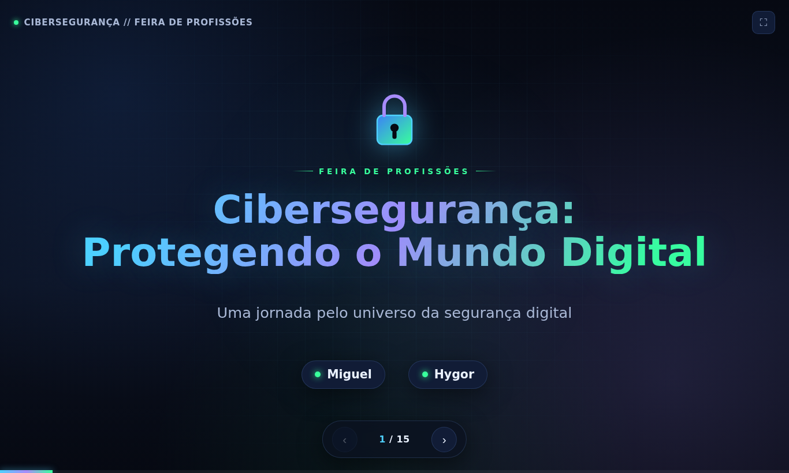

# Cibersegurança: Protegendo o Mundo Digital

Uma apresentação interativa, feita num único arquivo HTML, que eu e o Hygor usamos no nosso estande da Feira de Profissões.



**No ar:** https://cyberseguranca-feira-profissoes.vercel.app

## A ideia

A gente precisava explicar cibersegurança para quem passava no estande: alunos, pais, professores. Slides de PowerPoint não funcionam bem num notebook virado para o corredor, então fiz a apresentação como página web. Ela abre em qualquer navegador, vai para tela cheia com uma tecla e não depende de internet depois de carregada.

São 15 slides, começando no básico (o que é, ameaças, por que importa) e passando por tríade CIA, risco, golpes em redes sociais e e-mail, senhas fortes, gerenciador de senhas, as profissões da área e dicas práticas para levar para casa.

## Como usar

| Tecla | Ação |
|---|---|
| `→`, `Espaço`, `PageDown` | Próximo slide |
| `←`, `PageUp` | Slide anterior |
| `Home` / `End` | Primeiro / último slide |
| `F` | Tela cheia |

## Tecnologias

HTML, CSS e JavaScript puros, sem framework e sem build. Deploy estático na Vercel.

## Rodando localmente

```bash
git clone https://github.com/miguelguiul1/cyberseguranca-feira-profissoes.git
cd cyberseguranca-feira-profissoes
# abra o index.html no navegador, ou sirva a pasta:
npx serve .
```

## Licença

[MIT](LICENSE)
